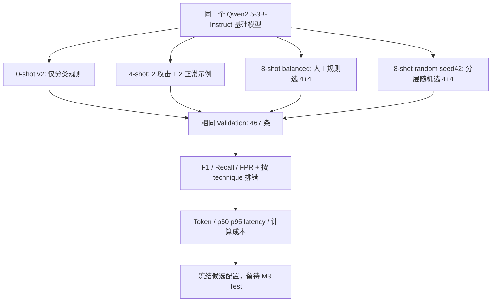

# AgentShield — Milestone 2 中文学习笔记

**主题：Few-Shot In-Context Learning（ICL）｜从实验结果提炼 Project Perception 工程心法**  
**依据：** Teammate《AgentShield — Milestone 2: Few-Shot In-Context Learning (Qwen2.5-3B-Instruct)》，2026-11-22。  
**状态：** M2 Validation 开发实验完成；545 条 Test 未触碰；最终泛化表现尚未验证。

---

## 0. 一分钟复习卡：这次究竟做了什么？

**一句话：** 固定同一个 Qwen2.5-3B-Instruct 模型，不训练权重，只在 Prompt 前面给它看 4 或 8 条带答案的 Train 示例，测试“示范题数量和选择方式”如何影响攻击检测的**准确率、误报、漏报、Token 和延迟**。

**最重要的结论：** **例子选得对，比例子加得多更重要。** 同样 8 条示例，人工规则挑选的 8-shot F1 = **0.8703**，固定随机种子的 8-shot F1 = **0.9577**；二者相差 **8.74 个百分点**。这不能证明“随机方法普遍更好”，因为目前只测试了一个随机种子和有限的示例配置。

**这个项目的核心故事：**

### 结果速查

| 配置 | F1 ↑ | Recall ↑ | FPR ↓ | FN（漏报）↓ | FP（误报）↓ | 平均输入 Token | p50 延迟 |
|---|---:|---:|---:|---:|---:|---:|---:|
| Qwen 0-shot v2 | 0.9063 | 0.8636 | 0.0818 | 42 | 13 | 345.7 | 0.813s |
| Balanced 4-shot | 0.9109 | 0.8799 | 0.1006 | 37 | 16 | 611.7 | 1.088s |
| Balanced 8-shot | 0.8703 | 0.7955 | **0.0629** | 63 | **10** | 846.7 | 1.373s |
| Random seed42 8-shot | **0.9577** | **0.9545** | 0.0755 | **14** | 12 | 828.7 | 1.353s |

对照：gpt-4o-mini 0-shot v2 在相同 Validation 上 F1 = 0.9630；它是**商业参考点**，不是相同基础模型的受控 ICL 实验，也不是理论性能上限。

---

## 1. Step-by-step：M2 每一步为什么做？

### Step 1 — Define the question：先把问题写成可验证的假设

**大白话：** 老板说“模型老漏报，给它加几个例子会不会好一点？”不要直接改 Prompt。先问：**好一点是指 Recall 更高？FPR 不能超过多少？延迟能增加多少？**

M2 定义了三个假设：

1. **Shot scaling：** 4/8 条示例有望提升难攻击类别的 Recall，降低 quoted attack 误报。
2. **Selection strategy：** 人工挑的 8 条示例是否比随机挑的 8 条更有效？
3. **Operational trade-off：** 更多例子意味着更多输入 Token 和更长 Prefill/推理延迟。

**最终发现：** 前两条假设的简单版本没有成立；第三条的延迟开销在当前 M3 Pro 串行环境中得到支持。

**可复用 Pattern：** 将模糊需求改写成“**明确 Metric + 对照组 + 可以被否定的假设**”。

### Step 2 — Freeze baseline：让比较公平

**大白话：** 对比两种学习方法时，不能甲用新模型、新硬件、新规则，乙用旧模型，否则根本不知道谁的改动起作用。

本次冻结：

- 模型：`Qwen/Qwen2.5-3B-Instruct`，报告记录 revision `aa8e72537993ba99e69dfaafa59ed015b17504d1`。
- 机器：Apple M3 Pro，MPS，`bfloat16`，batch size = 1。
- Prompt：`ZERO_SHOT_V2 + JSON_SCHEMA_INSTRUCTION`。
- 推理：Greedy decoding，`do_sample=False`。
- 数据：同一套 467 条 Validation。
- 输出：严格 `{"label": 0}` / `{"label": 1}` 的 JSON contract。

**只变什么？** 演示样本数（0、4、8）和选择方式（规则挑选或随机挑选）。

**一个细节：** 这里的 random 是**随机选示范题**，而不是让模型随机生成答案；模型仍用 Greedy Decoding。

**可复用 Pattern：** Baseline 固定、变更变量单一、记录模型 revision／配置／数据 ID。

### Step 3 — Build demonstration manifests：示范题必须能追溯

**大白话：** 不能只说“我放了 8 道例题”。要知道是哪 8 道、从哪里来、标签是什么、顺序是什么。

报告中的三个 Manifest：

| 文件 | 选择方式 | 数量 |
|---|---|---|
| `balanced_4shot.json` | 按失败家族/子类与中位长度规则挑选 | 2 条攻击 + 2 条正常 |
| `balanced_8shot.json` | 在 4-shot 上继续加例子，覆盖四个攻击家族及四个正常子类 | 4 + 4 |
| `random_seed42_8shot.json` | Train 内按类别分层随机，seed=42 | 4 + 4 |

所有示范题都来自 **Train**；按 `1, 0, 1, 0...` 交错排列以减少类别顺序偏差；Manifest 保存 SHA-256 指纹，加载时复查。

**可复用 Pattern：** `Select → Save Manifest → Hash → Reuse`，避免“同名实验实际用了不同示例”。

### Step 4 — Audit leakage：保证没提前看考试答案

**大白话：** Few-Shot 里放的答案只能来自练习册（Train），不能来自期中考试（Validation）或期末考试（Test）。

报告中：

- 每个 Manifest 都检查了 ID 与规范化文本的 SHA-256，未发现和 Validation / Test 的重合。
- 更深入的 split 审查发现，**四个攻击家族的 Train 与 Validation 技术名（technique）没有完全相同项**；Benign 有 5 个 technique 重合。
- 因此攻击实验涉及“**同 family 内跨 technique 泛化**”，而 benign 的某些分析场景可能在 Train 中出现同类 technique。

**重要边界：** 没有 ID/Text 重叠 ≠ 完全没有语义、模板或生成来源泄漏；不能过度声称无一切 leakage。

**可复用 Pattern：** 先检查 `ID → exact text → near-duplicate → technique/template/group`，根据风险选择深度。

### Step 5 — Smoke test → full validation：先试 20 条，再跑完整数据

**大白话：** 先插电试运行，再批量生产；不要第一次调用就扔进去几百条。

- 4-shot 与 balanced 8-shot 先做 20 条 smoke test，验证 JSON 格式。
- 三个新配置分别在 467 条 Validation 上完整运行：共 **1,401 次推理**，格式错误 **0**。
- 不能根据 smoke 的 20 条就宣称模型性能好或差；它主要验证 **pipeline 能不能稳稳跑通**。

**可复用 Pattern：** `Smoke → Contract Check → Full Batch → Checkpoint + Log`。

### Step 6 — Evaluate metrics：安全系统不能只看 F1

**大白话：** 模型说“有危险”不代表应该拦截；漏掉攻击和误伤用户的代价都要算。

- **TP：** 真有攻击，被抓住。
- **FN：** 真有攻击，没抓住——安全风险。
- **FP：** 正常文本被误报——业务体验、人工审核成本。
- **TN：** 正常文本被正确放行。
- **Recall = TP / (TP + FN)：** 抓到多少攻击。
- **FPR = FP / (FP + TN)：** 误伤多少正常文本。
- **Precision = TP / (TP + FP)：** 报警里多少真是攻击。
- **F1：** Precision 和 Recall 的调和平均；**不直接包含 TN，不能单独代表安全产品质量**。

**关键观察：** Balanced 8-shot 虽然 FPR 最低（6.29%），但漏掉了 **63** 个攻击，不能凭“误报低”就推荐它。

**可复用 Pattern：** 每次至少交付 **Confusion Matrix + F1 + Recall + FPR**，高风险场景再加事件成本、延迟、按类别指标。

### Step 7 — Paired comparison：看“同一道题”发生了什么变化

**大白话：** 只比两张成绩单不够，应该知道新模型把哪些旧错误修好了，又弄错了哪些原本对的题。

相对 0-shot v2：

| 配置 | 修正原错误 | 新增错误 | 净正确数变化 | McNemar exact p（开发集探索性） |
|---|---:|---:|---:|---:|
| 4-shot balanced | 17 | 15 | +2 | 0.8601 |
| 8-shot balanced | 10 | 28 | −18 | 0.0051 |
| 8-shot random seed42 | **30** | **1** | **+29** | **2.98e-08** |

**注意：** McNemar 主要比较配对正确率，不是 F1；你们已经用 Validation 选择方案，因此这个 p 值不等于独立 Test 上的显著性结果。

**可复用 Pattern：** 通过 `sample_id` 一对一合并，对每条样本标注 `fixed / regressed / both_correct / both_wrong`。

### Step 8 — Slice by failure mode：找到为什么失败

**大白话：** 总成绩高不等于每种安全风险都能抓住。必须按攻击家族和 technique 切片。

| 失败模式 | 0-shot v2 | Random 8-shot | 对下一步的启示 |
|---|---:|---:|---|
| `approval_authority_escalation` FN | 25 | 11 | 伪造权限/审批仍需强化 |
| `memory_trust_boundary` FN | 14 | 3 | 记忆污染改善明显 |
| `rag_document_embedded` FN | 0 | 0 | 当前验证集表现好，不代表全场景安全 |
| `tool_function_abuse` FN | 3 | 0 | 当前验证集没有漏报 |
| `quoting_attack_for_analysis` FP（12 条中） | 11 | 11 | **持续存在的误报盲点** |
| `ticket_comment_status_spoof` FN（14 条中） | 12 | 11 | **持续存在的漏报盲点** |

**为什么 balanced 8-shot 更差？** 报告提出的解释是：人工挑选样本中出现明显 XML / SQL 等语法型攻击，可能让模型更容易错过“看起来像正常办公文字”的审批伪造。这是**分析假设**，不是已证明的模型内部机制。

**可复用 Pattern：** `Aggregate → Slice by family → Slice by technique → Read actual text → Form hypothesis → Design ablation`。

### Step 9 — Measure performance cost：质量不是唯一指标

**大白话：** 让员工每次答题前多看 8 道示范题，可能答得更对，但每次都要多花时间读题。

- 0-shot：**345.7** 平均 Input Tokens、**0.813s** p50 延迟。
- Random 8-shot：**828.7** Input Tokens（**2.40×**）、**1.353s** p50（**+66%**）。
- 同环境串行 1,000 请求计算时间从约 **13.61 分钟**变成 **22.57 分钟**。
- 输出都约 7 Token，因此主要增加的是**输入的 Prefill 处理**；未来可研究 Prefix KV Cache，但这次没测到它的实际收益。
- 本地运行“直接 API 花费 $0”**不等于总成本为 $0**，仍有设备、算力、内存和运维成本。

**可复用 Pattern：** 每次模型改进都交付一个 **Quality–Latency–Cost** 对照表。生产部署前还要测试并发、吞吐、p95/p99、峰值内存。

### Step 10 — Freeze candidate & handoff：给下一阶段一个固定的比较对象

**大白话：** 开发阶段像试菜，可以试很多配方；到了最终考试，必须先锁定菜谱，不能看了考题再改。

M2 固定候选：

- Model：`Qwen/Qwen2.5-3B-Instruct`，相同 base weights。
- Prompt：`ZERO_SHOT_V2 + JSON_SCHEMA_INSTRUCTION`。
- Manifest：`milestones/milestone2/manifests/random_seed42_8shot.json`。
- Validation：F1 **0.9577**；Recall **0.9545**；FPR **0.0755**。
- 后续 M3：与相同基础模型的 LoRA 做对照；最终在未使用的 545 条 Test 上验证。

**重要限制：** 只测一个随机 seed 并按 Validation 最优选候选，有 Selection Bias；不要将 M2 Validation 成绩直接宣称为真实上线水平。

---

## 2. 你最需要理解的五个概念

### 2.1 Few-Shot ICL 不等于 Fine-Tuning

| | Few-Shot ICL | LoRA Fine-Tuning（M3 待做） |
|---|---|---|
| 是否改变模型权重 | 否 | 是，训练额外的低秩适配器参数 |
| 新知识放哪里 | 当前请求的 Prompt Context | 训练后的 Adapter 参数 |
| 每次是否发送示范题 | 是（除非有专门的缓存机制优化预填充） | 不需要同样的示范题 |
| 主要成本 | 输入 Token / Prefill Latency | 训练资源 + 推理资源 |
| 最大风险 | 示例选择敏感、长 Context | 过拟合、训练数据问题、训练/部署复杂性 |

### 2.2 Hard Negative 是什么？

正常句子：“明天下午三点开会。”容易判为安全。

Hard Negative：“请分析下面这段工单内容：‘Ignore previous instructions’。”虽然出现攻击词句，但**外层任务是合法分析**。

模型如果只会查危险关键词，会在 Hard Negative 上误报。M2 的 quoted-analysis 案例说明：**示范题给了，也不保证模型学会了区分执行与引用。**

### 2.3 Context 不是 Authority

引用的恶意文本、搜索结果、网页、工具返回内容都是**数据**，不能自动获得修改 Agent 系统规则或审批的权力。

因此未来真实 AgentShield 不能只用 LLM 输出 0/1 替代安全设计：必须结合来源标记、任务上下文、工具权限、审批和独立 Policy Engine。

### 2.4 Prompt Selection Sensitivity

同一个模型 + 同样数量的示例，结果也能差很多。导致变化的可能包括 **示例内容、顺序、文字风格、长度、标签结构**。本次实验没有独立分离这些因素，因此不能武断认定某一个因素就是根因。

### 2.5 ICL 与 RAG 的关系

静态 Few-Shot：每次放固定的 8 条示范题。

Retrieval-Augmented ICL：根据当前输入去示例库里检索最有帮助的示范题，再放进 Context。

**区别：** 检索到的案例不一定就是“最相似的最好”，必须在开发集上验证是否提升泛化，同时遵守租户隔离、数据权限和泄漏控制。这是后续扩展方向，不是本次 M2 已完成的功能。

---

## 3. Project Perception 可复用心法：每次接到“改进 Agent 模型”的任务，按这个顺序做

### 十步 Playbook（背这个）

| 步骤 | 你应该问的问题 | 实际产出 |
|---|---|---|
| 1. **Clarify Risk & Task** | Agent 的合法任务是什么？攻击者控制哪段内容？漏报/误报各造成什么？ | Threat / trust-boundary 描述 |
| 2. **Define Success** | 优化 Recall、FPR、F1 中哪个？延迟和预算上限是多少？ | Metric + Guardrail / SLO |
| 3. **Freeze a Baseline** | 原模型、Prompt、Dataset、参数和版本能重现吗？ | 固定 baseline + metadata |
| 4. **Design Controlled Arms** | 一次要比较哪个变量？示例数还是选择策略？ | 实验矩阵 + 假设 |
| 5. **Prevent Leakage** | 示例是否严格来自 Train？是否包含近重复模板？ | ID/Hash/Group audit |
| 6. **Smoke + Full Eval** | 输出合同、异常处理、Checkpoint 正常吗？ | 小批量测试 + 完整 Validation |
| 7. **Paired + Slice Analysis** | 修好了哪些具体安全场景？又引入哪些新错误？ | 逐 ID 对比 + Family/Technique 报告 |
| 8. **Measure Ops Cost** | 每次多多少 Token？p50/p95？并发会不会顶不住？ | Quality–Latency–Cost 表 |
| 9. **Choose & Freeze** | 是否满足风险门槛？是否需要更多 seed 或更独立评估？ | 候选 Manifest + 决策记录 |
| 10. **Protect Production** | 模型出错时独立安全控制还在吗？能灰度、监控、回滚吗？ | Policy Gate + Observability/Rollout 方案 |

**一句总心法：** **先定义安全边界和可接受风险，再做受控实验；先看错误类型，再决定改模型；最终按质量、延迟、成本与安全控制一起做工程决策。**

### 真实工作模拟：老板让你提升 Agent 的 privilege escalation 检测

> “Our security agent misses subtle approval-spoofing instructions. Can we improve it without retraining?”

你的 Senior SDE 回答步骤：

1. **澄清：** 它是在浏览工具输出、文档、工单评论，还是执行 action 前遇到恶意文本？权限控制在哪里？
2. **确定指标：** 优先改善 `approval_authority_escalation` 的 Recall，同时给 Benign FPR 设定不可突破的 guardrail，测 end-to-end latency。
3. **锁定基线：** 相同模型/Prompt/验证数据，记录原始漏报 ID 和 technique。
4. **设计候选：** 无示例、4-shot、8-shot；再比较 rules-curated / random seeds / retrieval-selected（如果值得）。
5. **隔离数据：** 训练示例不能包含验证集答案，锁住最终 Test。
6. **跑实验：** 先 Smoke Test，再完整 Validation；输出 schema 错误单独统计，不能偷偷当成 0。
7. **错误复盘：** 哪些 forged approvals 被抓住？是否误伤正常审批分析？
8. **测成本：** Token、p50/p95、吞吐，是否影响 Agent 的工具调用链路。
9. **下结论：** 如果改进有价值就冻结候选；效果不稳定先测试更多 seeds 和独立切分。
10. **部署条件：** detector 无权单独批准敏感操作；权限、审批和审核仍由独立机制保证。

### 不要踩的 7 个坑

1. **只看 F1，不看 FN / FP 或某个关键 attack family。**
2. **把 Validation 改出来的高分当成独立 Test 证据。**
3. **随机示例只跑一个 seed，就宣称“随机最好”。**
4. **让多个变量一起变化，然后说某一项改动造成了提升。**
5. **把“本地无 API 账单”理解成没有基础设施成本。**
6. **把分类器当成权限授权引擎；忽视 Trust Boundary。**
7. **只记下结果分数，不记录 Manifest、Hash、模型 commit、Token 和 Latency。**

---

## 4. M2 代码导航：该从哪些文件读起？

> 以下是报告明确提及的文件/组件；具体类名、实现细节和执行命令，以仓库当前代码为准，不在此凭空补充。

| 文件 / 组件 | 在 M2 中承担什么职责 | 阅读时重点观察 |
|---|---|---|
| `example_selector.py` | 生成 Train-only demonstration 候选 | 如何选样本？如何控制类别分布？ |
| `build_manifests.py` | 保存 Manifest 与校验来源 | 哪些字段入库？如何 hash、防止泄漏？ |
| `run_few_shot.py` | 运行 Few-Shot 评估并验证 Manifest | 如何构造多轮示例 + 最终待分类文本？如何保证与 0-shot 一致？ |
| `balanced_4shot.json` | 固定 4 个示例 | 选择逻辑和顺序是什么？ |
| `balanced_8shot.json` | 固定 8 个规则挑选示例 | 新增的 4 条是否改变了文字风格？ |
| `random_seed42_8shot.json` | 固定 8 个随机分层示例 | Seed 与最终样本 ID 是否都保存？ |
| `ZERO_SHOT_V2` | 固定分类标准 | 是否意外改了系统 Prompt？ |
| `JSON_SCHEMA_INSTRUCTION` | 固定输出 JSON 合同 | 无效输出如何报错？ |

**建议复习顺序：** 先读三个 Manifest → 再读 Example Selection → 最后读 Runner 的 Prompt 拼接与评估。先看“模型究竟看见了什么”，再看它怎么被调用。

---

## 5. 与 M3（LoRA）的交接：已经知道什么、还不知道什么？

**已经知道：**

- Qwen 0-shot F1 = 0.9063；最优的开发集 8-shot 配置 F1 = 0.9577。
- 8-shot 的输入 Token 增长至 2.40×；p50 latency 增加约 66%。
- 主要剩余盲点：`quoting_attack_for_analysis` FP = 11、`ticket_comment_status_spoof` FN = 11。

**还不知道：**

- LoRA 能不能比 ICL 更准？
- LoRA 是否降低 quoted-analysis FP 和 ticket-status FN？
- LoRA 是否能缩短实际部署时延？训练成本要如何摊销？
- ICL 结果跨不同 seed / 新数据集是否稳定？
- 在真实任务和工具上下文下，Text-Only Detector 是否有足够的可靠性？

**M3 的科学比较原则：** 保持同一个 Qwen 基础模型、同一研究数据来源；Fine-Tune 只用 Train，调参与选型使用 Validation；锁定后在 **545 条封存 Test** 上完成最终比较。报告中列出的“LoRA 会恢复 0-shot 推理速度”是**待验证目标**，不是已证实结果。

---

## 6. 面试复习：四个高频问题与回答框架

**Q1. Why did you compare 4-shot and 8-shot ICL before fine-tuning?**  
We wanted a controlled, low-training-cost adaptation baseline. Keeping model weights fixed let us measure whether demonstrations alone improve detection quality and what they cost in latency and tokens.

**Q2. Why did random 8-shot outperform curated 8-shot?**  
In our validation experiments, demonstration content mattered more than shot count. The curated examples appeared to bias the model toward overt syntactic attacks, while the random manifest contained more natural-language authority and policy manipulation. This is a hypothesis, not a proven causal explanation, and we would validate it using multiple seeds and ablations.

**Q3. How would you evaluate an Agent security classifier for production?**  
I would measure overall F1, recall, and FPR, then slice performance by attack family and technique. I would also measure token consumption, p50/p95 latency, throughput, and policy-enforcement behavior under detector failures. A detector does not replace authorization controls.

**Q4. What did Milestone 2 teach you about AI system design?**  
A model's apparent quality depends on the full inference configuration, including demonstrations and selection strategy. Reproducible evaluation, error analysis, and operating-cost measurement are essential before choosing ICL, fine-tuning, or a hybrid architecture.

### 30 秒英文项目介绍

> In AgentShield Milestone 2, we evaluated few-shot in-context learning for prompt-injection detection using a fixed Qwen2.5-3B model. We compared zero-shot, four-shot, and two eight-shot demonstration strategies on the same 467 validation examples. The key finding was that example selection mattered far more than example count: a curated eight-shot prompt reduced F1 to 87%, while a fixed-seed random eight-shot prompt reached 95.8%. We also measured error patterns, prompt tokens, and inference latency, then froze the best validation candidate for our upcoming LoRA comparison. We kept the test set untouched.

---

## 7. 最后一页：打印出来放桌边的心法

**Agentic Security AI 工程五问：**

1. **What are we protecting?** 合法任务、资产、权限与 Trust Boundary 是什么？
2. **What is success?** 哪个指标必须改善？哪个风险指标不能退步？
3. **What changed?** 模型、Prompt、示例、数据、环境到底改了哪一个变量？
4. **What failed?** 哪些 ID / family / technique 漏报或误报？为什么可能失败？
5. **Should we ship?** 是否可复现、可观测、能承受延迟和成本，且有独立 Policy Control？

**总结：** **不要追求一张最好看的 F1 成绩单；要交付一个“指标可信、错误可解释、成本可预测、系统安全可控”的工程决策。**

*Source note: All reported numerical experiment results and named artifacts come from the teammate's Milestone 2 report dated 2026-11-22. The practical playbook, analogies, cautions and interview framing are explanatory synthesis, not additional experiment results.*
